<!-- ANIMATED HEADER BANNER (AZURE TO CYBER CYAN WAVE) -->

<!-- ANIMATED TYPING SVG HEADLINE -->

 

<!-- QUICK BADGES BAR -->

 

📬 **Get in touch:** <a href="mailto:mdirshadalam91190@gmail.com">mdirshadalam91190@gmail.com</a>

---

## 👨‍💻 Executive Summary

> **"Architecting scalable multi-cloud platforms, resilient automation pipelines, and zero-trust cloud infrastructure."**

I am a **Senior Azure DevOps Engineer & Multi-Cloud Infrastructure Architect** with **11+ years of total IT experience**, including **5+ years of specialized expertise** across Microsoft Azure, AWS, GCP, Terraform (IaC), Azure Kubernetes Service (AKS), CI/CD automation, and DevSecOps.

Currently driving cloud transformations at **Ericsson Global India**, architecting enterprise **Hub-and-Spoke Azure Landing Zones**, modular Terraform frameworks, automated deployment pipelines, and shift-left security controls.

* 🎯 **Core Domains:** Infrastructure as Code (Terraform), Cloud Architecture (Azure/AWS/GCP), Kubernetes (AKS), Enterprise CI/CD (Azure DevOps & GitHub Actions), DevSecOps.
* 💼 **Open To:** Senior & Lead Cloud/DevOps Architect Roles, Global Remote Consulting, and Enterprise Engineering Initiatives.

---

## 🏛️ Enterprise Multi-Cloud & DevOps Architecture Blueprint

```mermaid
flowchart LR
    subgraph Developer["👨‍💻 Developer & Version Control"]
        GIT["Git / GitHub / Azure Repos"] --> PR["Branching & Controlled Pull Requests"]
    end

    subgraph CI_CD["⚙️ Automated CI/CD & DevSecOps Gate"]
        PR --> PIPELINE["Azure DevOps / GitHub Actions"]
        subgraph Security["🛡️ Shift-Left Security Scans"]
            TFLINT["TFLint Syntax Check"]
            CHECKOV["Checkov IaC Compliance"]
            TRIVY["Trivy Container Scan"]
            SONAR["SonarQube Quality Gate"]
        end
        PIPELINE --> Security
    end

    subgraph IaC["🏗️ Infrastructure as Code"]
        Security --> TF["Terraform Core Engine"]
        TF --> BACKEND["Azure Blob Remote State + Concurrency Lease Locking"]
        TF --> MODULES["Reusable Enterprise Modules"]
    end

    subgraph MultiCloud["☁️ Enterprise Multi-Cloud Deployments"]
        MODULES --> AZURE["🔷 Microsoft Azure\n(Hub-Spoke VNet, AKS, Key Vault, App Gateway)"]
        MODULES --> AWS["🔶 Amazon Web Services\n(VPC, EKS, S3, IAM)"]
        MODULES --> GCP["🔴 Google Cloud Platform\n(VPC, GKE, Cloud Storage)"]
    end

    subgraph Monitoring["📊 Observability & Reliability"]
        AZURE & AWS & GCP --> OBS["Prometheus | Grafana | Azure Monitor | Log Analytics"]
    end

    classDef primary fill:#0078D4,stroke:#002050,stroke-width:2px,color:#fff;
    classDef security fill:#D83B01,stroke:#701200,stroke-width:2px,color:#fff;
    classDef cloud fill:#107C41,stroke:#043918,stroke-width:2px,color:#fff;
    class AZURE,AWS,GCP cloud;
    class Security,TFLINT,CHECKOV,TRIVY,SONAR security;
    class PIPELINE,TF,MODULES primary;
```

---

## 🧰 Technology Stack & Tooling

### 🌐 Cloud, Containers & Automation Toolchain

 

| Domain | Enterprise Skills & Tools |
| :--- | :--- |
| ☁️ **Cloud Platforms** | **Microsoft Azure** (Primary), **AWS** (Amazon Web Services), **GCP** (Google Cloud Platform) |
| 🏗️ **Infrastructure as Code (IaC)** | **Terraform** (Reusable Modules, Dynamic Blocks, `for_each`, Workspaces, Remote State & Locking), **Ansible** |
| ☸️ **Containers & Orchestration** | **Kubernetes**, **Azure Kubernetes Service (AKS)**, **Docker**, Azure Container Registry (ACR), Helm |
| 🔄 **CI/CD & Source Control** | **Azure DevOps YAML Pipelines**, **GitHub Actions**, Git, GitHub, GitLab, Multi-stage Releases |
| 🌐 **Azure Networking** | Hub-and-Spoke Architecture, VNet Peering, Subnets, NSG, Azure Application Gateway, Azure Firewall, Bastion, Private Endpoints, Private DNS |
| 🛡️ **DevSecOps & Code Quality** | **Checkov**, **Trivy**, **tfsec**, **TFLint**, **Terrascan**, **Gitleaks**, **SonarQube**, Shift-Left IaC Scanning |
| 🔐 **Identity, Governance & Compliance** | Microsoft Entra ID (Azure AD), Azure RBAC, PIM (Privileged Identity Management), Azure Policy, Management Groups, Key Vault |
| 📈 **Observability & Reliability** | **Prometheus**, **Grafana**, **Azure Monitor**, Log Analytics Workspaces, Application Insights, Azure Site Recovery (ASR) |
| 💻 **Scripting & OS** | **Linux (RHEL/Ubuntu)**, **Bash**, **PowerShell**, **Azure CLI**, Python Automation |

---

## 🚀 Featured Enterprise Repositories

<table width="100%">
  <tr>
    <td width="50%" valign="top">
      <h3>🔷 <a href="https://github.com/Irshad50/terraform-azure-modules">terraform-azure-modules</a></h3>
      
<b>Production-Ready Modular Azure Infrastructure</b>

      
Modular, highly scalable Terraform framework implementing Hub-Spoke VNets, Subnets, NSGs, Key Vault, and Compute with environment isolation (Dev, Stage, Prod).

      

        
        
        
      

    </td>
    <td width="50%" valign="top">
      <h3>⚡ <a href="https://github.com/Irshad50/terraform-azure-devops-pipeline">terraform-azure-devops-pipeline</a></h3>
      
<b>Automated Azure DevOps CI/CD Multi-Stage Pipeline</b>

      
Enterprise YAML pipeline featuring automated linting, security scans (Checkov/TFLint), plan approvals, and zero-downtime execution with remote state synchronization.

      

        
        
        
      

    </td>
  </tr>
  <tr>
    <td width="50%" valign="top">
      <h3>🌐 <a href="https://github.com/Irshad50/terraform-azure-landing-zone">terraform-azure-landing-zone</a></h3>
      
<b>Enterprise Azure Landing Zone & Governance</b>

      
Scalable Cloud Adoption Framework (CAF) implementation using Management Groups, Azure Policy, RBAC, and centralized logging.

      

        
        
      

    </td>
    <td width="50%" valign="top">
      <h3>🔒 <a href="https://github.com/Irshad50/terraform-remote-backend-state-locking">terraform-remote-backend-state-locking</a></h3>
      
<b>Distributed State Management & Concurrency Locking</b>

      
Production setup for Terraform remote state stored in encrypted Azure Blob Storage with automated lease locking and access control.

      

        
        
      

    </td>
  </tr>
  <tr>
    <td width="50%" valign="top">
      <h3>🛣️ <a href="https://github.com/Irshad50/terraform-azure-networking">terraform-azure-networking</a></h3>
      
<b>Hub & Spoke Network Architecture via <code>for_each</code></b>

      
Enterprise networking blueprint provisioning VNets, subnets, peering, route tables, and NSG associations dynamically using nested maps.

      

        
        
      

    </td>
    <td width="50%" valign="top">
      <h3>🏢 <a href="https://github.com/Irshad50/terraform-azure-prod">terraform-azure-prod</a></h3>
      
<b>Production Infrastructure with Data Blocks & Reusable Modules</b>

      
Complete deployment of production VMs, NICs, Public IPs, and Storage Accounts utilizing Terraform Data Sources and secure credential injection.

      

        
        
      

    </td>
  </tr>
</table>

---

## 📊 Live GitHub Activity & Insights

 

---

## 💼 Let's Connect & Collaborate

Whether you are looking to build or optimize enterprise Cloud & DevOps infrastructure:

* 💼 **LinkedIn:** [linkedin.com/in/md-irshad-alam-0a5278220](https://www.linkedin.com/in/md-irshad-alam-0a5278220)
* 📬 **Email:** `mdirshadalam91190@gmail.com`
* 📍 **Location:** Bangalore, India *(Open to Global Remote & Relocation)*

 

<!-- ANIMATED FOOTER WAVE -->

